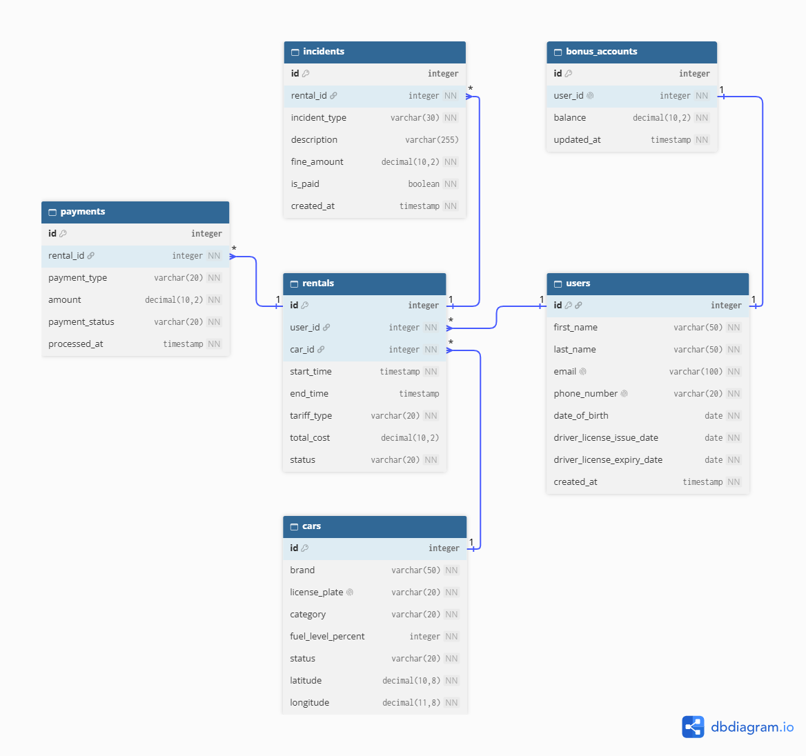

# Каршеринг — учебная база данных

Проект по дисциплине «Язык SQL», экономический факультет БГУ, 2 курс.
Стек: PostgreSQL + DBeaver.

**Команда:** 16
**Тема:** база данных сервиса каршеринга

## Состав и зоны ответственности

| Участник | Таблицы |
|---|---|
| Руденко Никита | `users`, `rentals` |
| Люкевич Григорий | `cars`, `bonus_accounts` |
| Савченков Кирилл | `payments`, `incidents` |

## ER-диаграмма



Исходник диаграммы для [dbdiagram.io](https://dbdiagram.io): [`docs/er_diagram.dbml`](docs/er_diagram.dbml)

## Таблицы

| Таблица | Что хранит |
|---|---|
| `users` | клиенты и их водительские права |
| `bonus_accounts` | бонусный счёт клиента (1:1 с `users`) |
| `cars` | автомобили: категория, статус, топливо, координаты |
| `rentals` | аренды: кто, какую машину, когда, по какому тарифу и за сколько |
| `payments` | оплаты и возвраты по арендам |
| `incidents` | штрафы и повреждения, привязанные к аренде |

## Как запустить

1. Создать пустую базу в DBeaver.
2. Выполнить `schema.sql` целиком (Alt+X).
3. Выполнить `seed.sql` целиком.
4. Запросы по неделям лежат в `queries/`, файлы `weekNN_Фамилия.sql`.

## Структура репозитория

```
schema.sql            создание таблиц, ограничений и индексов
seed.sql              тестовые данные
docs/                 ER-диаграмма
queries/              запросы по темам курса
README.md
```
